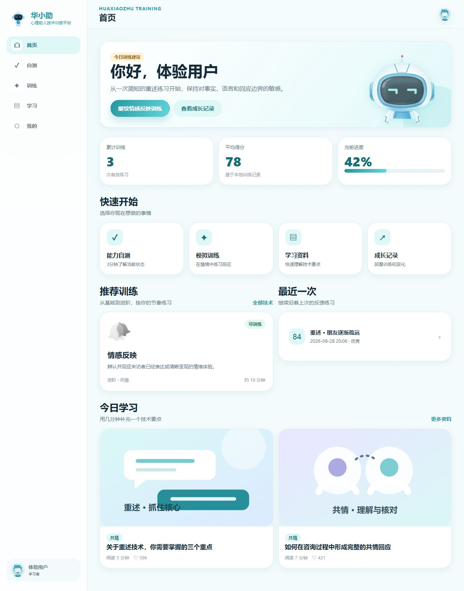
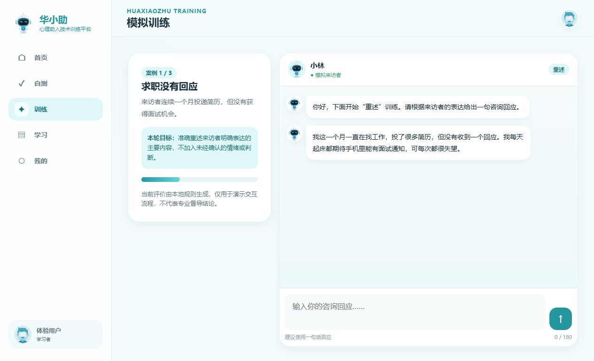
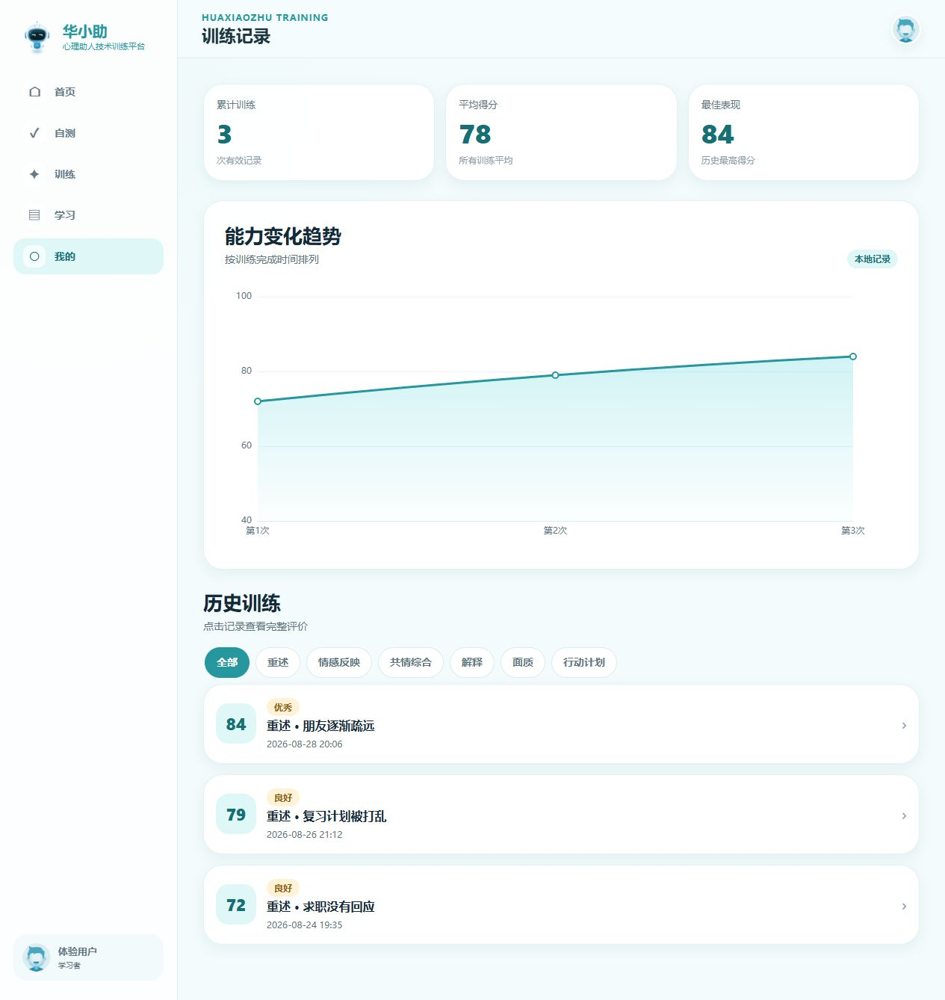
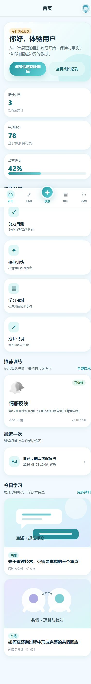

  
  <h1>华小助 · Helping Skills Lab</h1>
  
<strong>离线、透明、可自托管的心理助人技能训练原型</strong>

  

    <a href="README.md">简体中文</a>
    ·
    <a href="README.en.md">English</a>
  

  

    
    
    
    
    
  

> [!IMPORTANT]
> 当前反馈由浏览器内的**关键词与可解释规则**生成，不调用大语言模型，也不构成心理测评、诊断、咨询或专业督导意见。

## 它能做什么

华小助把“导学—练习—反馈—复盘”组织成一套可直接演示的静态站点。无需后端、数据库或云服务，打开页面即可体验完整流程。

| 模块 | 当前实现 |
| --- | --- |
| 技术导学 | 重述、情感反映、共情综合、解释、面质、行动计划 |
| 情境练习 | 六类技术的模拟案例、逐轮回应与重试 |
| 本地反馈 | 按事实覆盖、表达长度、判断性用语和基本表达形态计算 |
| 能力自测 | 两套学习导向自测、自动保存、维度结果与训练建议 |
| 成长记录 | 本地训练历史、趋势图、详情与打印 |
| 多端体验 | 手机底部导航、桌面侧栏及打印样式 |

## 立即体验

需要 [Node.js 18+](https://nodejs.org/)；项目没有需要安装的 npm 依赖。

~~~bash
git clone https://github.com/wsLuYao/huaxiaozhu-helping-skills.git
cd huaxiaozhu-helping-skills
npm start
~~~

然后访问 <http://127.0.0.1:8080>，选择“游客体验”。也可将仓库内容直接部署到任意静态主机。

## 工作方式

~~~mermaid
flowchart LR
  A[导学内容] --> B[模拟对话]
  B --> C[本地规则评价]
  C --> D[训练结果]
  D --> E[(LocalStorage)]
  E --> F[记录与趋势]
  G[能力自测] --> E
~~~

- 页面层：17 个语义清晰的 HTML 入口。
- 应用层：原生 JavaScript，统一挂载在 `window.HXZ`。
- 数据层：课程、案例与题目位于 `assets/js/data.js`。
- 可视化：随仓库分发的 Apache ECharts 5.3.2。
- 持久化：浏览器 LocalStorage；没有网络同步。

## 界面预览

<table>
  <tr>
    <td width="50%"> 模拟训练</td>
    <td width="50%"> 记录与趋势</td>
  </tr>
</table>

查看移动端首页

## 规则反馈的边界

评价器位于 `assets/js/pages-training.js`。它匹配案例中的关键事实与提示词，并结合回应长度、判断/说教用语等显式特征给出练习反馈。规则可读、可修改，适合教学原型和交互研究；它**不能理解真实来访者、判断助人能力，也不能替代人工督导**。

自测结果同样只用于选择练习方向，不是经过临床验证的量表结果。请勿在紧急、诊疗或高风险场景中使用本项目作决策。

## 数据与隐私

- 登录、回答、自测和记录只保存在当前浏览器。
- 项目运行时不加载 CDN，也不会主动上传数据。
- 清理浏览器数据或在“个人中心”选择“清除本地数据”即可删除记录。
- 演示登录不是安全的真实账号系统，请勿输入真实密码或敏感资料。

详见[数据与隐私说明](docs/data-and-privacy.zh-CN.md)。

## 项目结构

~~~text
.
├── *.html                     # 17 个静态页面
├── assets/
│   ├── css/                   # 组件、页面与响应式样式
│   ├── images/                # 项目图像与开源版 SVG 插画
│   ├── js/                    # 数据、应用内核与页面控制器
│   └── vendor/echarts.min.js  # 本地图表依赖
├── docs/                      # 架构、部署、隐私与截图
├── scripts/serve.mjs          # 零依赖本地静态服务器
└── tests/static-check.mjs     # 语法、引用与回归检查
~~~

## 验证

~~~bash
npm test
~~~

检查涵盖 JavaScript 语法、17 个页面的本地资源引用、外部运行时请求、商业字体残留，以及弹窗监听、记录筛选、图表释放和规则评价的回归场景。CI 会在每次提交和 Pull Request 上运行同一套检查。

## 文档

- [架构与实现](docs/architecture.zh-CN.md)
- [静态部署](docs/deployment.zh-CN.md)
- [数据与隐私](docs/data-and-privacy.zh-CN.md)
- [第三方资源](docs/third-party.zh-CN.md)

## 参与贡献

欢迎提交问题和改进。开始前请阅读[贡献指南](CONTRIBUTING.md)、[安全政策](SECURITY.md)和[行为准则](CODE_OF_CONDUCT.md)。

## 许可

原创代码与开源版插画采用 [MIT License](LICENSE)。Apache ECharts 及品牌标识等边界见 [NOTICE](NOTICE.md)。

  为学习与研究而构建 · Built for learning and research

